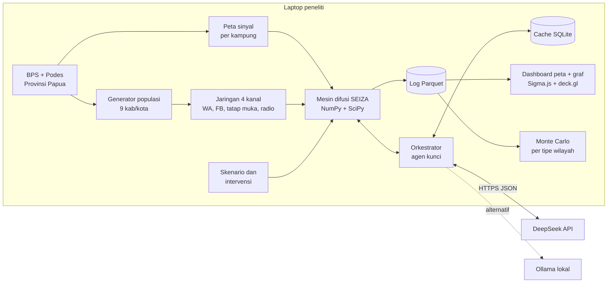

# PRD — Indonesia Sintetis

**Fase 1: Provinsi Papua**

| | |
|---|---|
| Versi | 0.2 (fokus Papua) |
| Tanggal | 4 November 2026 |
| Pemilik | Baginda Rizky |
| Status | Draf untuk ditinjau |

> Laboratorium simulasi sosial untuk menguji bagaimana hoaks menyebar di Provinsi Papua, dari grup WhatsApp di Sentani sampai cerita dari mulut ke mulut di kampung tanpa sinyal, dan intervensi mana yang paling cepat meredamnya sebelum berujung kekerasan.
>
> Demo visual beranimasi tersedia di versi halaman web interaktif PRD ini.

---

## Daftar isi

1. [Ringkasan](#1-ringkasan)
2. [Mengapa Papua](#2-mengapa-papua)
3. [Masalah](#3-masalah)
4. [Tujuan, non-tujuan & metrik](#4-tujuan-non-tujuan--metrik)
5. [Pengguna & calon mitra](#5-pengguna--calon-mitra)
6. [Model simulasi untuk Papua](#6-model-simulasi-untuk-papua)
7. [Sumber data](#7-sumber-data)
8. [Kebutuhan fungsional](#8-kebutuhan-fungsional)
9. [Kebutuhan visual & animasi](#9-kebutuhan-visual--animasi)
10. [Kontrak LLM agen kunci](#10-kontrak-llm-agen-kunci)
11. [Arsitektur & teknologi](#11-arsitektur--teknologi)
12. [Kebutuhan non-fungsional](#12-kebutuhan-non-fungsional)
13. [Roadmap](#13-roadmap)
14. [Risiko, mitigasi & etika](#14-risiko-mitigasi--etika)
15. [Kriteria penerimaan MVP](#15-kriteria-penerimaan-mvp)
16. [Pertanyaan terbuka](#16-pertanyaan-terbuka)

---

## 1. Ringkasan

**Indonesia Sintetis** adalah perangkat lunak riset yang membangun masyarakat virtual dengan profil demografis nyata, menghubungkannya lewat jaringan komunikasi, lalu mensimulasikan penyebaran sebuah hoaks jam demi jam untuk menguji intervensi tandingan.

**Fase 1 berfokus pada Provinsi Papua** (pascapemekaran 2022, beribu kota di Jayapura) yang terdiri dari 9 kabupaten/kota. Dengan penduduk sekitar satu juta jiwa, simulasi 1 juta agen di sini mendekati **representasi 1:1**: hampir setiap warga punya satu "kembaran sintetis".

Pendekatannya **hibrida**:

- **Mayoritas agen** digerakkan model matematis (agent-based model) yang ringan dan berjalan di laptop.
- **Sekitar 100–300 agen kunci** diperankan LLM melalui API DeepSeek dengan persona berbahasa Melayu Papua. Mereka adalah pendeta, ondoafi dan kepala suku, kepala kampung, mama-mama pasar, serta akun media sosial lokal.

### Wilayah Fase 1

Tingkat sinyal di bawah ini adalah perkiraan awal untuk demo dan harus diganti dengan data Podes.

| Kabupaten/Kota | Tipe wilayah | Sinyal (perkiraan) |
|---|---|---|
| Kota Jayapura | Kota | Kuat |
| Kab. Jayapura | Kota/pedalaman | Kuat |
| Keerom | Perbatasan/pedalaman | Sedang |
| Sarmi | Pesisir | Lemah |
| Mamberamo Raya | Pedalaman/sungai | Lemah |
| Waropen | Pesisir | Lemah |
| Kepulauan Yapen | Kepulauan | Sedang |
| Biak Numfor | Kepulauan | Kuat |
| Supiori | Kepulauan | Lemah |

---

## 2. Mengapa Papua

- **Taruhannya nyawa.** Pada Februari 2023, isu penculikan anak di Wamena memicu kerusuhan yang menewaskan sekitar 10 orang. Wamena kini masuk Provinsi Papua Pegunungan, tetapi polanya (isu beredar cepat, orang asing dicurigai, eskalasi dalam hitungan jam) relevan untuk seluruh Tanah Papua.
- **Komunikasi berlapis.** Di kota seperti Jayapura, Sentani, dan Biak, WhatsApp dan Facebook dominan. Di kampung pedalaman dan pesisir terpencil, kabar bergerak lewat tatap muka: ibadah di gereja, pasar, pertemuan adat, dan orang yang turun ke kota lalu pulang membawa cerita.
- **Kesenjangan sinyal.** Akses internet di Papua masih tertinggal dibanding provinsi lain. Akibatnya, hoaks tetap menyebar dari mulut ke mulut, sementara klarifikasi resmi yang hanya diunggah di media sosial tidak pernah sampai.
- **Otoritas sosial yang khas.** Gereja, tokoh adat (ondoafi di wilayah Tabi, mananwir di Biak), dan kepala kampung sering lebih dipercaya daripada akun resmi pemerintah.
- **Riset yang langka.** Hampir tidak ada model penyebaran informasi yang memperhitungkan struktur sosial dan keterbatasan infrastruktur Papua. Kontribusi kebaruannya tinggi.

> **Hipotesis kerja.** Di Papua, intervensi yang menumpang pada kanal tepercaya dan tidak bergantung pada internet (gereja, tokoh adat, radio) akan jauh lebih efektif daripada klarifikasi resmi di media sosial, terutama di kabupaten bersinyal lemah.

---

## 3. Masalah

- Respons terhadap hoaks pemicu kekerasan umumnya reaktif dan berpusat pada media sosial, kanal yang justru lemah di sebagian besar wilayah Papua.
- Belum ada cara aman dan dapat diulang untuk membandingkan strategi tandingan sebelum krisis terjadi. Uji coba langsung di masyarakat tidak etis.
- Model penyebaran informasi yang ada dibangun untuk masyarakat yang selalu daring dan tidak mengenal peran gereja, adat, serta radio.

> **Pernyataan masalah.** Pemerintah daerah, aparat, dan tokoh masyarakat di Provinsi Papua belum punya alat berbasis bukti untuk menentukan siapa yang harus meluruskan isu, lewat kanal apa, dan seberapa cepat, agar hoaks tidak berujung kekerasan.

---

## 4. Tujuan, non-tujuan & metrik

### Tujuan

- Membangun simulasi penyebaran hoaks yang memperhitungkan kanal daring dan luring serta kesenjangan sinyal antarkabupaten di Provinsi Papua.
- Membandingkan efektivitas intervensi: waktu, pembawa pesan (aparat, gereja, adat, radio), dan kanal.
- Menghasilkan rekomendasi SOP respons hoaks per tipe wilayah (kota, pesisir, pedalaman, kepulauan).

### Non-tujuan

- Tidak memantau, memprofilkan, atau mengidentifikasi orang sungguhan. Semua agen fiktif.
- Tidak memodelkan, menilai, atau mengklasifikasi ekspresi dan aspirasi politik sebagai hoaks.
- Tidak ditujukan untuk operasi keamanan terhadap kelompok tertentu, dan tidak memakai asal etnis sebagai faktor kecurigaan.
- Tidak menyediakan fitur untuk merancang atau mengoptimalkan pesan hoaks.

### Metrik keberhasilan

| Metrik | Target awal | Cara ukur |
|---|---|---|
| Kesesuaian pola | Simulasi mereproduksi jeda waktu dari munculnya isu hingga eskalasi pada kasus rujukan | Linimasa kasus Wamena 2023 dari pemberitaan dan wawancara, dibandingkan dengan keluaran model |
| Validitas tatap muka | Mayoritas panel tokoh lokal menilai perilaku agen kunci "masuk akal" | FGD dengan tokoh gereja, adat, dan jurnalis lokal di Jayapura |
| Stabilitas hasil | Peringkat intervensi konsisten pada interval kepercayaan 95% | ≥ 200 putaran Monte Carlo per skenario |
| Kinerja | 1 juta agen × 96 langkah < 5 menit | Laptop RAM 16 GB tanpa GPU |
| Biaya LLM | Di bawah batas anggaran per skenario | Penghitung token bawaan, disesuaikan tarif DeepSeek terbaru |

---

## 5. Pengguna & calon mitra

| Peran | Siapa | Kebutuhan |
|---|---|---|
| Utama | **Peneliti** | Membangun skenario, mengkalibrasi model, menjalankan eksperimen, dan menulis hasil |
| Sekunder | **Pemda & aparat** (Diskominfo Provinsi Papua, Polda Papua, pemkab) | Rekomendasi yang jelas per tipe wilayah |
| Validator | **Tokoh & lembaga lokal** (sinode gereja, lembaga masyarakat adat, jurnalis lokal) | Memeriksa apakah perilaku agen dan rekomendasi sesuai kenyataan |
| Mitra akademik | **Peneliti Papua** (misalnya Universitas Cenderawasih) | Pengetahuan kontekstual, bahasa, dan legitimasi penelitian |

---

## 6. Model simulasi untuk Papua

### Status agen (SEIZA)

| Status | Arti |
|---|---|
| **S**: Rentan | Belum mendengar kabar |
| **E**: Terpapar | Sudah mendengar, belum bersikap |
| **I**: Penyebar | Percaya dan menyebarkan |
| **Z**: Skeptis | Tidak percaya atau meluruskan |
| **A**: Siaga aktif | Percaya dan siap bertindak di lapangan (jaga kampung, menghadang orang tak dikenal) |

Status **A** adalah pembeda utama dari model rumor klasik. Ia mengukur potensi tindakan fisik, bukan sekadar penyebaran informasi.

### Empat lapisan kanal

| Kanal | Karakter di Papua | Bergantung sinyal? |
|---|---|---|
| WhatsApp | Grup keluarga, jemaat, marga, sekolah. Sangat tepercaya. | Ya |
| Facebook | Grup info kota dan jual-beli. Menghubungkan kampung dengan kerabat di Jayapura. | Ya |
| Tatap muka | Ibadah, pasar, pertemuan adat, pangkalan ojek, perahu antarpulau | Tidak |
| Radio | RRI dan radio komunitas. Jangkauannya luas, termasuk kampung tanpa internet. | Tidak |

### Peluang transmisi

```text
p(S→E) = β[kanal] × aktivitas_penyebar × kepercayaan_relasi
         × sinyal[kabupaten]        // = 1 untuk tatap muka dan radio
         × faktor_identitas          // mis. orang tua anak sekolah ×1,5
         × (1 − 0,45 × literasi_digital)
         × faktor_prebunking

aktivitas_penyebar = exp(−umur_sejak_percaya / τ)
sinyal[kabupaten]  = proporsi kampung dengan sinyal 4G/internet (dari Podes)

Indeks risiko wilayah = (jumlah agen A / populasi) × kehadiran pemicu
                        (orang tak dikenal, kendaraan asing)
```

### Agen kunci khas Papua

- **Pendeta dan pastor:** menjangkau jemaat lewat ibadah dan grup WhatsApp jemaat. Kepercayaan sangat tinggi.
- **Tokoh adat:** ondoafi (Jayapura, Sentani), mananwir (Biak, Supiori), dan kepala suku. Keputusannya bisa menggerakkan satu kampung.
- **Kepala kampung** dan **tokoh pemuda**, yang sering menjadi penggerak ronda atau jaga kampung.
- **Mama-mama pasar**, simpul kabar dari mulut ke mulut antara kota dan kampung.
- **Akun media sosial lokal**, yang bisa membuat isu meloncat lintas kabupaten dan pulau.

### Skenario intervensi awal

| Kode | Skenario |
|---|---|
| A | Tanpa intervensi (baseline) |
| B | Klarifikasi resmi di media sosial, T+24 jam |
| C | Klarifikasi resmi di media sosial, T+6 jam |
| D | Klarifikasi lewat gereja dan tokoh adat, T+12 jam |
| E | Prebunking lewat gereja dan sekolah sebelum isu muncul |
| F | Siaran radio RRI dan radio komunitas, T+12 jam |

### Contoh skenario isu (hipotetis)

> *"Hati-hati e! Ada orang pake mobil putih culik anak sekolah di Sentani. Dong ambil organ. Su ada 3 anak hilang. Sebar ke keluarga semua!"*
>
> Ditanam di 5 grup WhatsApp orang tua murid di Sentani (Kab. Jayapura) pada T+0. Akun Facebook/TikTok lokal mengunggah ulang video lama pada T+10 jam.

---

## 7. Sumber data

| Data | Dipakai untuk |
|---|---|
| BPS Provinsi Papua: Sensus Penduduk 2020 (long form) dan proyeksi terbaru | Populasi per kabupaten/kota, usia, pendidikan, agama, rumah tangga dengan anak usia sekolah |
| BPS: Potensi Desa (Podes) | Ketersediaan sinyal seluler dan internet per kampung, keberadaan gereja, pasar, dan sekolah |
| Survei APJII | Penetrasi internet dan platform yang paling banyak dipakai di wilayah Papua |
| Data BTS dan akses internet (BAKTI Komdigi, bila tersedia) | Memperhalus peta sinyal |
| Pemberitaan, arsip cek fakta, wawancara | Linimasa kasus rujukan (Wamena 2023) untuk kalibrasi pola |
| FGD dan wawancara tokoh lokal | Struktur jaringan sosial, bobot kepercayaan, dan validasi perilaku agen kunci |

---

## 8. Kebutuhan fungsional

| ID | Kebutuhan | Prioritas |
|---|---|---|
| FR-01 | **Generator populasi Papua** untuk 9 kabupaten/kota dari tabel BPS, hingga tingkat distrik dan kampung, dengan seed acak tetap | P0 |
| FR-02 | **Peta sinyal** per kampung dari Podes yang memengaruhi kanal daring | P0 |
| FR-03 | **Generator jaringan empat kanal**: WhatsApp, Facebook, tatap muka (gereja, pasar, adat), dan radio, termasuk ikatan kampung–kota dan antarpulau | P0 |
| FR-04 | **Mesin difusi SEIZA** tervektorisasi dengan langkah waktu dapat diatur, termasuk siklus harian (ibadah Minggu, hari pasar) | P0 |
| FR-05 | **Editor skenario**: isu, titik tanam, waktu, dan emosi pesan (YAML dan antarmuka) | P0 |
| FR-06 | **Modul intervensi Papua**: klarifikasi resmi di media sosial, lewat gereja dan tokoh adat, siaran radio, dan prebunking | P0 |
| FR-07 | **Orkestrator agen kunci LLM** (DeepSeek) dengan persona Melayu Papua dan keluaran JSON tervalidasi | P0 |
| FR-08 | **Cache keputusan** (SQLite) dan pembekuan tabel keputusan sebelum Monte Carlo | P0 |
| FR-09 | **Runner Monte Carlo** paralel per skenario | P0 |
| FR-10 | **Analisis per tipe wilayah**: kota, pesisir, pedalaman, kepulauan | P0 |
| FR-11 | **Modul kalibrasi** terhadap linimasa kasus rujukan dan masukan FGD | P1 |
| FR-12 | **Log peristiwa** (Parquet) untuk replay dan analisis | P0 |
| FR-13 | **Mode model lokal** (Ollama) sebagai pembanding dan opsi kedaulatan data | P1 |
| FR-14 | **Ekspor laporan** dan **pelacak biaya** token per skenario | P1 |

---

## 9. Kebutuhan visual & animasi

| ID | Kebutuhan | Prioritas |
|---|---|---|
| V-01 | **Graf jaringan geografis beranimasi** (WebGL): node ditempatkan sesuai koordinat kampung di atas peta Provinsi Papua, 60 fps hingga ±50 ribu node tampil, dengan agregasi kabupaten → distrik → kampung saat di-zoom | P0 |
| V-02 | **Warna status konsisten** (S abu, E kuning, I merah, Z teal, A ungu) plus bentuk atau pola untuk pengguna buta warna | P0 |
| V-03 | **Denyut transmisi** sepanjang edge (merah untuk hoaks, teal untuk koreksi) dan pendar node saat berubah status | P0 |
| V-04 | **Gaya edge per kanal**: WhatsApp padat, tatap muka bertitik, Facebook tipis, unggahan viral putus-putus, dan gelombang melingkar untuk siaran radio | P1 |
| V-05 | **Lapisan peta sinyal** yang bisa dinyalakan atau dimatikan, agar terlihat mengapa klarifikasi daring gagal di wilayah tertentu | P0 |
| V-06 | **Peta risiko per distrik** (choropleth, MapLibre + deck.gl) yang tersinkron dengan graf | P0 |
| V-07 | **Timeline scrubber & replay** dengan kurva SEIZA yang bergerak bersama graf | P0 |
| V-08 | **Mode bandingkan berdampingan** dua skenario dengan seed sama | P1 |
| V-09 | **Panel agen dan feed peristiwa**, termasuk jawaban LLM mentah untuk agen kunci | P1 |
| V-10 | **Ekspor video dan PNG** resolusi tinggi untuk presentasi kepada mitra | P1 |
| V-11 | **Tema gelap dan terang**, dan penghormatan pada pengaturan *reduced motion* | P2 |

---

## 10. Kontrak LLM agen kunci

API DeepSeek kompatibel dengan format OpenAI. Prompt sistem dan glosarium Melayu Papua diletakkan di awal agar mendapat diskon cache. Setiap jawaban harus lolos validasi skema. Jika gagal, coba ulang maksimal dua kali, lalu kembali ke aturan bawaan ABM.

**Prompt sistem (tetap)**

```text
Kamu memerankan warga FIKTIF di Provinsi Papua dalam simulasi riset akademik.
Gunakan cara berpikir dan bahasa sesuai persona. Jawab hanya JSON sesuai skema.
Jangan menambahkan fakta baru, nama orang sungguhan, atau tuduhan terhadap kelompok.
```

**Glosarium singkat (tetap)**

```text
"sa" = saya, "ko" = kamu, "dong" = mereka, "kitorang" = kita,
"su" = sudah, "tra" = tidak, "jang" = jangan, ...
```

**Persona (per agen)**

```json
{
  "nama": "Pdt. Markus",
  "peran": "Pendeta jemaat",
  "wilayah": "Serui, Kep. Yapen",
  "usia": 49,
  "jangkauan": "±300 jemaat, 4 grup WA",
  "sinyal": "sedang",
  "nilai": ["melindungi jemaat", "hati-hati terhadap kabar dari luar"]
}
```

**Konteks (per keputusan)**

```json
{
  "kabar_masuk": "Hati-hati e! Ada orang pake mobil putih culik anak sekolah di Sentani...",
  "dari": "grup WA keluarga",
  "komentar": ["...", "..."],
  "klarifikasi_terlihat": [],
  "hari": "Sabtu, besok ibadah"
}
```

**Keluaran wajib**

```json
{
  "aksi": "teruskan | abaikan | luruskan | tanya_dulu",
  "kanal": "wa | mimbar_ibadah | tatap_muka | tidak_ada",
  "keyakinan": 0.0,
  "ajakan_jaga_kampung": false,
  "pesan_tambahan": "maks. 280 karakter",
  "alasan_singkat": "..."
}
```

**Pemetaan ke ABM**

| Aksi LLM | Status ABM |
|---|---|
| `teruskan` | I, atau A bila `ajakan_jaga_kampung` benar |
| `luruskan` | Z dengan bobot koreksi tinggi |
| `abaikan` | Z pasif |
| `tanya_dulu` | Tetap E satu langkah lagi |

> **Risiko bahasa.** LLM umumnya lemah dalam Melayu Papua dan konteks budaya lokal. Setiap persona dan contoh jawaban wajib ditinjau penutur asli sebelum dipakai, dan hasil DeepSeek dibandingkan dengan model lain.

---

## 11. Arsitektur & teknologi



### Tumpukan teknologi

| Lapisan | Pilihan |
|---|---|
| Simulasi | Python 3.11, NumPy, SciPy sparse, python-igraph, GeoPandas untuk batas wilayah |
| LLM | SDK `openai` (base_url DeepSeek) + asyncio + tenacity, Pydantic untuk validasi JSON |
| Penyimpanan | SQLite (cache), Parquet + DuckDB (log & analisis) |
| Backend | FastAPI + WebSocket untuk mengalirkan langkah simulasi |
| Frontend | React + Vite, Sigma.js + Graphology (graf WebGL), deck.gl + MapLibre (peta Papua), Apache ECharts (kurva) |
| Analisis | Jupyter, statsmodels, SALib (analisis sensitivitas) |

---

## 12. Kebutuhan non-fungsional

- **Perangkat:** laptop RAM 16 GB tanpa GPU untuk skala penuh (±1 juta agen). Prototipe cukup 8 GB.
- **Replikasi:** setiap putaran mencatat seed, versi kode, versi model LLM, dan hash prompt.
- **Biaya:** LLM dipanggil hanya saat agen kunci menerima informasi baru, dan keputusan dibekukan sebelum Monte Carlo sehingga ratusan putaran tidak menambah biaya API.
- **Privasi & kedaulatan data:** hanya persona fiktif dan teks hoaks yang sudah publik yang dikirim ke API eksternal. Data hasil FGD dan wawancara tidak pernah dikirim ke LLM.
- **Keluaran agregat:** hasil hanya disajikan per kampung, distrik, atau kabupaten, tidak pernah per individu atau kelompok etnis.

---

## 13. Roadmap

| Minggu | Fase | Keluaran |
|---|---|---|
| 1–4 | **Fondasi Papua** | Data BPS dan Podes untuk 9 kabupaten/kota, populasi 10 ribu agen, jaringan empat kanal, visual peta dasar |
| 5–8 | **Kalibrasi & validasi lapangan** | Linimasa kasus Wamena 2023, FGD di Jayapura bersama tokoh gereja, adat, dan jurnalis untuk bobot kepercayaan |
| 9–12 | **Agen kunci DeepSeek** | Persona Melayu Papua yang ditinjau penutur asli, cache, pelacak biaya, panel agen |
| 13–16 | **Skala penuh & eksperimen** | ±1 juta agen (mendekati 1:1), Monte Carlo enam skenario, analisis per tipe wilayah |
| 17–20 | **Analisis & lokakarya hasil** | Analisis sensitivitas, pembanding model lokal, lokakarya hasil bersama mitra di Jayapura, penulisan laporan |

---

## 14. Risiko, mitigasi & etika

Papua adalah wilayah dengan sejarah konflik dan isu hak asasi manusia yang sensitif. Penelitian ini harus dirancang agar melindungi warga, bukan menambah risiko bagi mereka.

| Risiko | Mitigasi |
|---|---|
| Hasil disalahgunakan untuk pengawasan atau menekan ekspresi politik | Ruang lingkup dibatasi pada hoaks pemicu kekerasan terhadap warga sipil. Ekspresi politik di luar cakupan. Keluaran hanya agregat. Kode dan model dibagikan terbatas. |
| Stereotip terhadap Orang Asli Papua atau pendatang | Asal etnis tidak dipakai sebagai faktor kecurigaan. Persona dan parameter ditinjau peneliti Papua. |
| LLM tidak memahami bahasa dan budaya Papua | Glosarium, tinjauan penutur asli, pembanding beberapa model, dan pelaporan keterbatasan secara terbuka |
| Data kalibrasi terbatas dan kasus rujukan berada di provinsi lain | Kalibrasi pola, bukan angka absolut. Validasi kualitatif lewat FGD dan analisis sensitivitas. |
| Data sinyal tidak mutakhir | Gunakan Podes terbaru, silangkan dengan data BTS, dan uji sensitivitas terhadap parameter sinyal |
| Kedaulatan data (server DeepSeek di luar negeri) | Hanya data sintetis yang dikirim. Sediakan mode model lokal. |
| Biaya API membengkak | Cache, pembekuan keputusan, batas token per skenario |

### Prinsip etika

- Libatkan peneliti dan tokoh Papua sejak desain, bukan hanya saat pengambilan data.
- Ajukan kaji etik dan izin penelitian sesuai ketentuan yang berlaku sebelum kerja lapangan.
- Kembalikan hasil kepada komunitas dalam bentuk yang bisa mereka pakai, misalnya panduan meluruskan hoaks untuk gereja dan kampung.

---

## 15. Kriteria penerimaan MVP

- [ ] Simulasi 100 ribu agen di 9 kabupaten/kota selama 48 jam simulasi selesai di laptop, dengan hasil identik untuk seed yang sama.
- [ ] Kanal tatap muka dan radio berjalan tanpa bergantung sinyal, sedangkan kanal daring mengikuti peta sinyal.
- [ ] Keenam skenario dapat dibandingkan per tipe wilayah beserta interval kepercayaannya.
- [ ] Minimal 50 agen kunci berbahasa Melayu Papua berjalan dengan DeepSeek, lolos validasi JSON, dan ditinjau penutur asli.
- [ ] Peta, graf beranimasi, dan kurva tersinkron, bisa di-replay, dan bisa diekspor menjadi video.

---

## 16. Pertanyaan terbuka

1. Apakah cakupan perlu diperluas ke Papua Pegunungan, tempat kasus rujukan Wamena 2023 terjadi, atau bahkan ke seluruh Tanah Papua?
2. Siapa mitra akademik dan penutur asli yang bisa memvalidasi persona dan bahasa?
3. Izin penelitian dan kaji etik apa saja yang diperlukan untuk FGD di Jayapura?
4. Apakah data Podes terbaru tersedia hingga tingkat kampung untuk seluruh 9 kabupaten/kota?
5. Berapa anggaran API dan waktu penelitian yang tersedia?

---

## Lampiran: referensi awal

- [Papua (province) — Wikipedia](https://en.wikipedia.org/wiki/Papua_(province))
- [BPS Provinsi Papua — Potret Sensus Penduduk 2020](https://papua.bps.go.id/en/publication/2021/03/19/9c5a44ce92993244f5d9d106/potret-sensus-penduduk-2020-provinsi-papua.html)
- [2023 Wamena riot — Wikipedia](https://en.wikipedia.org/wiki/2023_Wamena_riot)
- [Kompas TV — 9 warga tewas dalam kerusuhan di Wamena imbas isu penculikan anak](https://www.kompas.tv/article/381729/9-warga-tewas-dalam-kerusuhan-di-wamena-imbas-isu-penculikan-anak)
- [Katadata — Kerusuhan Wamena sebabkan 10 orang tewas](https://katadata.co.id/berita/nasional/63f8677866c39/kerusuhan-wamena-sebabkan-10-orang-tewas-polda-papua-turunkan-brimob)
- [Bisnis.com — Penetrasi internet dan literasi digital Papua belum optimal](https://teknologi.bisnis.com/read/20241203/101/1821030/penetrasi-internet-dan-literasi-digital-papua-belum-optimal)
